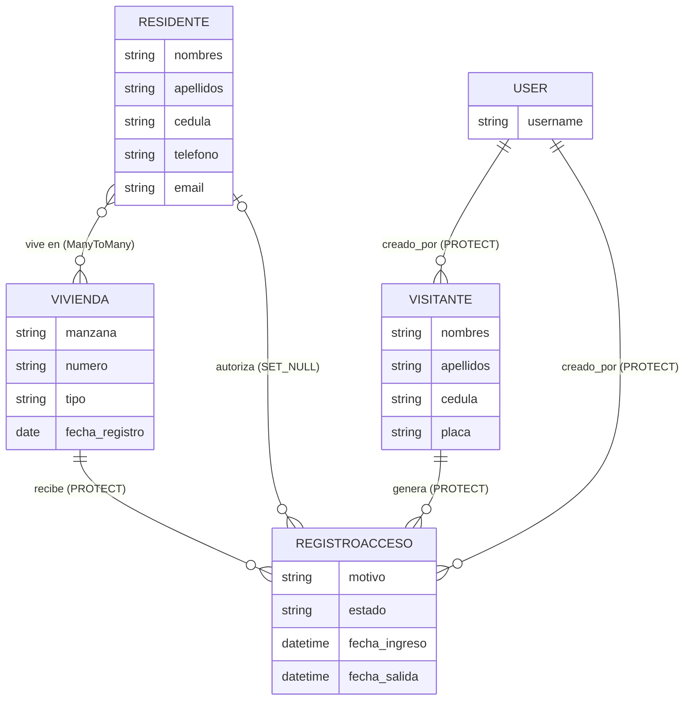

# Control de acceso a la urbanización

Aplicación web hecha con Django para registrar y controlar el ingreso de visitantes a una urbanización: qué visitante entra, a qué vivienda va, qué residente lo autoriza y quién del personal lo registró.

- **Tema asignado:** control de acceso a una urbanización
- **Autor:** Erick Peña
- **Tecnologías:** Python 3.12 o superior, Django 6.1.3, SQLite

## Modelo de datos

El sistema tiene cuatro tablas relacionadas:



| Modelo | Qué representa | Relaciones |
|---|---|---|
| `Vivienda` | Casa o departamento de la urbanización (manzana y número únicos) | Muchos residentes (ManyToMany); muchos registros de acceso |
| `Residente` | Persona que vive en la urbanización | Varias viviendas (ManyToMany); autoriza registros de acceso |
| `Visitante` | Persona externa que ingresa | Muchos registros de acceso; `creado_por` (usuario) |
| `RegistroAcceso` | Cada ingreso: motivo, estado, fecha de ingreso y de salida | FK a visitante, vivienda, residente autorizador y usuario `creado_por` |

Decisiones de modelado:

- `PROTECT` en visitante y vivienda: no se pueden borrar si tienen historial de accesos.
- `SET_NULL` en el residente autorizador: si se elimina, el registro se conserva.
- Campos de opciones (`TextChoices`): tipo de vivienda, motivo y estado del acceso.

## Estructura del proyecto

```
urbanizacion-app/
  config/                  # settings.py, urls.py, wsgi.py
  accesos/
    models/                # un archivo por modelo + __init__.py que los importa
    forms/                 # un ModelForm por entidad + formulario de registro
    views/                 # vistas de función por entidad + auth_views.py
    urls/                  # rutas por entidad + __init__.py que las reúne
    templates/accesos/     # base.html y una carpeta por entidad
    management/commands/   # crear_grupos.py y cargar_datos.py
    migrations/
    permisos.py            # regla de propiedad
    templatetags/          # filtro puede_modificar para las plantillas
    admin.py
  manage.py
  requirements.txt
```

## Cómo levantar el proyecto desde cero (Windows, PowerShell)

1. Clonar el repositorio y entrar a la carpeta:

   ```powershell
   git clone URL_DEL_REPOSITORIO
   cd urbanizacion-app
   ```

2. Crear y activar el entorno virtual:

   ```powershell
   python -m venv venv
   .\venv\Scripts\Activate.ps1
   ```

   Si PowerShell bloquea el script, ejecutar antes `Set-ExecutionPolicy -Scope CurrentUser RemoteSigned`.

3. Instalar las dependencias:

   ```powershell
   python -m pip install -r requirements.txt
   ```

4. Crear las tablas:

   ```powershell
   python manage.py migrate
   ```

5. Cargar los datos de prueba (crea los grupos, los usuarios y al menos 6 registros por tabla):

   ```powershell
   python manage.py cargar_datos
   ```

   El comando se puede ejecutar varias veces sin duplicar datos.

6. Iniciar el servidor:

   ```powershell
   python manage.py runserver
   ```

7. Abrir `http://127.0.0.1:8000/` en el navegador. El panel de administración está en `http://127.0.0.1:8000/admin/`.

Para verificar el proyecto: `python manage.py check`.

## Usuarios de prueba

| Usuario | Contraseña | Rol |
|---|---|---|
| `admin` | `Admin12345` | Superusuario |
| `administrador1` | `Admin2026!` | Grupo `administradores` |
| `consultor1` | `Consul2026!` | Grupo `consultores` |
| `consultor2` | `Consul2026!` | Grupo `consultores` |

Los usuarios que se registran desde la pantalla de registro entran automáticamente al grupo `consultores`.

## Grupos y permisos

Los grupos se crean por código con `python manage.py crear_grupos` (también lo ejecuta `cargar_datos`).

| Grupo | Puede | No puede |
|---|---|---|
| `administradores` | Ver, crear, editar y eliminar en las cuatro entidades | — |
| `consultores` | Ver listados y detalles de las cuatro entidades; crear registros de acceso | Crear, editar o eliminar visitantes; editar o eliminar registros de acceso que no creó |

**Regla de propiedad:** quien creó un registro de acceso puede editarlo y eliminarlo. Otro usuario del mismo grupo no puede, ni por botón ni por URL directa (responde 403). El administrador puede modificar cualquier registro.

Las vistas están protegidas con `@login_required` y `@permission_required`, y los botones se ocultan en las plantillas según `perms`.

## Declaración de IA

La arquitectura del proyecto conjunto las reglas de negocio, el modelado de datos y las decisiones de diseño son autoría exclusiva de mi persona Peña Erick en base a las directrices del ING. Franciso Higuera. Durante el proceso se empleó inteligencia artificial (GEMINI PRO) unicamente como asistente técnico de soporte para acelerar la depuración de errores, revisar indentaciones y sintaxis, destrabar incidencias con ramas de Git y refinar fragmentos de código o scripts. 